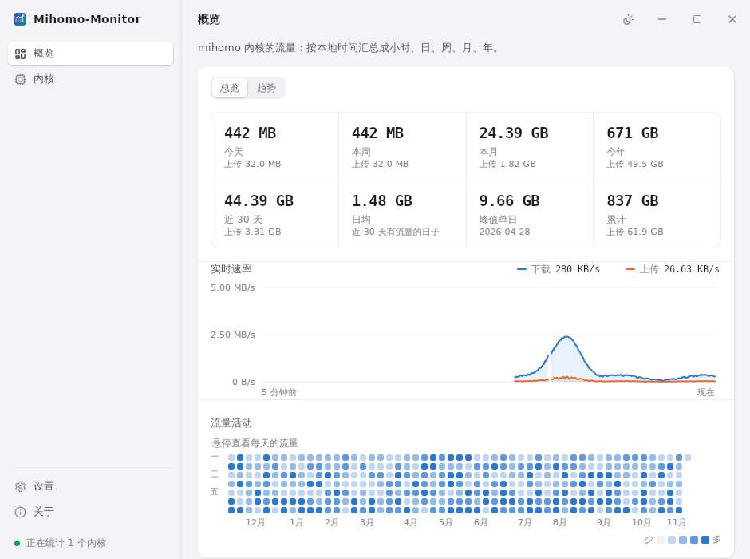
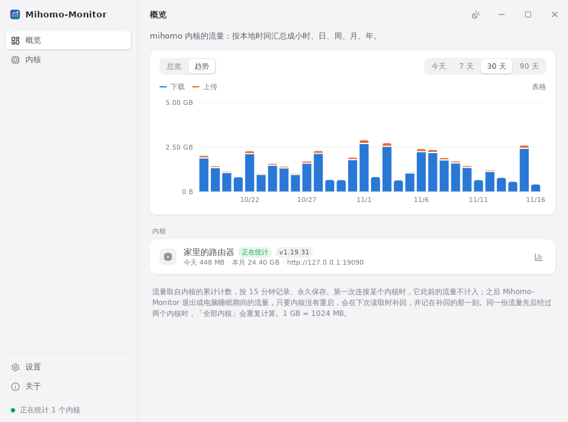
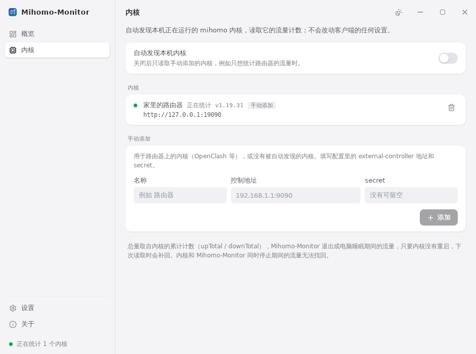

<div align="center">


# Mihomo-Monitor

**像 vnstat 一样统计 mihomo 内核的流量：直接读取你已经在用的 Clash 客户端，常驻托盘，几乎不占资源。**

基于 Tauri 2（Rust + React）构建，支持 Windows 与 macOS。


<picture>
  <source media="(prefers-color-scheme: dark)" srcset="docs/images/overview-dark.png">
  
</picture>

</div>

## 目录

- [功能概览](#功能概览)
- [快速开始](#快速开始)
- [内核发现](#内核发现)
- [统计口径](#统计口径)
- [后台常驻](#后台常驻)
- [数据存储](#数据存储)
- [开发](#开发)
- [发布](#发布)
- [路线图](#路线图)
- [已知限制](#已知限制)

## 功能概览

| 功能 | 说明 |
| --- | --- |
| 直接读取已有内核 | 自动找到 Clash Verge Rev 等客户端正在运行的 mihomo 内核，通过它的控制接口读取流量计数；不内置内核，不接管、不改动你的代理 |
| vnstat 式记账 | 按 15 分钟记录、永久保存，按本地时间汇总成小时、日、周、月、年 |
| 不漏记 | 以内核的累计计数（`upTotal` / `downTotal`）为准；Mihomo-Monitor 退出或电脑睡眠期间，只要内核没有重启，流量会在下次读取时补回 |
| 实时速率与热力图 | 最近 5 分钟的下载与上传速率曲线，一年每天流量的热力图 |
| 多个内核 | 本机与路由器（OpenClash 等）的内核可以同时统计，分别查看或合计 |
| 常驻托盘 | 开机自启，托盘悬停显示今日用量；轻量模式下关闭窗口会连界面一起释放 |

## 快速开始

1. 安装并打开 Mihomo-Monitor。首次启动会开启开机自启，之后它在托盘（菜单栏）里运行。
2. 打开你平时用的 Clash 客户端（例如 Clash Verge Rev）。几秒内 **内核** 页会出现这个内核，状态为「正在统计」。
3. **概览** 页的「总览」显示今天、本周、本月、今年、近 30 天、日均、峰值单日与累计用量，最近 5 分钟的实时速率，以及一年的流量热力图；「趋势」按今天每小时或近 7 / 30 / 90 天每天显示下载与上传，悬停查看数值，也可以切换成表格。同时统计多个内核时，可以分别查看或合计。

第一次连接某个内核时，它此前累计的流量不会计入（和 vnstat 第一次看到网卡时一样），统计从这一刻开始。

<div align="center">

</div>

<div align="center">

</div>

## 内核发现

Mihomo-Monitor 依次尝试下面几种方式，找到的每个候选都会先用 `GET /version` 确认是 mihomo 内核：

| 方式 | 说明 |
| --- | --- |
| 读取内核进程的启动参数 | 客户端通常用 `-d`、`-f`、`-ext-ctl-unix`、`-ext-ctl-pipe` 启动内核；Mihomo-Monitor 由此找到控制接口，必要时再读配置文件里的 `external-controller` 与 `secret` |
| Clash Verge Rev 的已知位置 | 读不到启动参数时（例如 Windows 上以 SYSTEM 运行的服务模式），macOS 检查用户临时目录与服务目录下的 `verge-mihomo*.sock`，Windows 列出以 `verge-mihomo` 开头的命名管道 |
| 常用端口 | 以上都没有结果时，探测 `127.0.0.1` 的 9090 与 9097 端口；设置了 secret 时提示手动添加 |
| 手动添加 | 在 **内核** 页填写控制地址与 secret，适合路由器上的内核或没有被自动发现的内核 |

unix socket 与 Windows 命名管道不需要 secret（mihomo 不在这两个通道上校验 secret，靠文件权限限制访问），所以本机的 Clash Verge Rev 通常不用做任何设置。只想统计路由器时，可以在 **内核** 页关闭「自动发现本机内核」。

已实测：macOS 上的 Clash Verge Rev 2.5.6（服务模式，mihomo v1.19.31）。其他客户端（Mihomo Party、FlClash、ClashX Meta）与 Windows 上的 Clash Verge Rev 尚未逐一实测，欢迎反馈。

## 统计口径

- **总量取自内核的累计计数。** 每次读数与上一次相减得到增量；计数变小说明内核重启过，此时当前计数全部是新流量。
- **断点续算。** 每分钟把增量和当前计数（检查点）在同一个事务里写入数据库。Mihomo-Monitor 重启后，如果内核还是同一个进程（进程号与启动时间都没变），中间的流量从计数差补回；内核换了进程且启动在检查点之后，它的全部计数都算新流量。内核与 Mihomo-Monitor 同时停止期间的流量无法找回。
- **补回的流量记在补回的时刻。** 中间这段时间里每一刻用了多少已经无从得知，所以按小时看时它会集中在恢复读取的那一格。
- **时区。** 数据按 UTC 存成 15 分钟一格。所有时区与 UTC 都相差整数个 15 分钟，所以换时区后按天汇总依旧准确；夏令时当天按 23 或 25 小时计算。
- **单位。** 1 GB = 1024 MB，与多数代理客户端和机场的计法一致。
- **多个内核合计。** 同一份流量如果先后经过两个内核（例如本机内核的出站又经过路由器的内核），合计时会重复计算，概览页会提示。

## 后台常驻

- 主窗口在需要时才创建。**轻量模式**（默认开启）下关闭窗口会销毁界面，只留下 Rust 后台进程继续统计；关闭轻量模式时关窗只是隐藏，再打开更快。
- macOS 上没有窗口时，应用不出现在程序坞与切换器里。
- 后台只订阅 `/traffic`（每秒一行），增量在内存中累加，每分钟写一次盘；界面关闭时不向前端推送任何数据。
- 开机自启以 `--tray` 参数启动，不弹出窗口。

## 数据存储

| 系统 | 位置 |
| --- | --- |
| macOS | `~/Library/Application Support/Mihomo-Monitor` |
| Windows | `%LOCALAPPDATA%\Mihomo-Monitor` |

目录中有 `traffic.db`（SQLite，WAL 模式）、`settings.json` 与 `logs/`。可以用环境变量 `MIHOMO_MONITOR_HOME` 改用其他目录。数据库结构用 `PRAGMA user_version` 标记版本，升级时自动迁移。

## 开发

需要 Node.js 22、pnpm 11 与 Rust 1.95（`app/rust-toolchain.toml` 会自动选用）。

```bash
cd app
pnpm install
pnpm tauri dev          # 开发运行
pnpm typecheck          # 前端类型检查
pnpm test:rust          # Rust 测试
```

没有装 Clash 客户端也可以试用：用模拟内核，然后在 **内核** 页手动添加 `127.0.0.1:19090`。

```bash
python3 app/scripts/fake-mihomo.py --port 19090
```

代码按层组织（`domain` → `infra` → `service` → `shell`），设计说明见 [docs/design.md](docs/design.md)。

### README 截图

```bash
app/scripts/readme-screenshots.sh
```

只能在 macOS 上运行，使用已安装的 `/Applications/Mihomo-Monitor.app`。脚本用 `MIHOMO_MONITOR_HOME` 指向示例目录、关闭自动发现、只连模拟内核，并用 `app/scripts/demo-data.py` 生成一年的虚构流量，不会读到或改动你自己的内核与统计。需要给终端授予「辅助功能」与「屏幕录制」权限。

## 发布

1. 在仓库的 **Settings → Secrets and variables → Actions** 中添加 `TAURI_SIGNING_PRIVATE_KEY`（updater 签名私钥的内容，无密码）。对应的公钥已写在 `app/src-tauri/tauri.conf.json`。
2. 修改 `app/package.json`、`app/src-tauri/Cargo.toml` 与 `app/src-tauri/tauri.conf.json` 中的版本号并提交。
3. 推送 `vX.Y.Z` 标签，`release.yml` 会构建 Windows 与 macOS（Apple Silicon、Intel）安装包，生成更新说明并发布；应用内的更新检查读取最新 Release 的 `latest.json`。

想在发布前试装某个提交，可以在 Actions 页手动运行 **Test build**。

## 路线图

- [x] 托盘常驻、轻量模式、开机自启、自动更新
- [x] 内核发现（启动参数、配置文件、Clash Verge Rev 已知位置、手动添加）
- [x] 总量统计：日 / 周 / 月 / 年、实时速率、断点续算
- [ ] 按节点、订阅、DIRECT、进程、入站、域名拆分（读取 `/connections`）
- [ ] 按订阅设置计费周期与配额，对照机场返回的已用量
- [ ] 更多客户端的实测与适配

## 已知限制

- 第一次连接某个内核时，它此前的累计流量不计入。
- 远程内核（手动添加的地址）看不到进程，只能靠计数是否变小来判断重启：如果它在 Mihomo-Monitor 停止期间重启，并且新的计数已经超过上次记录的值，这段时间会少记。
- 原版 Clash 与 Clash Premium 不支持；mihomo 也需要是 `/traffic` 带 `upTotal` / `downTotal` 累计计数的版本，较旧的版本会在 **内核** 页提示升级。

## License

[MIT](LICENSE)
