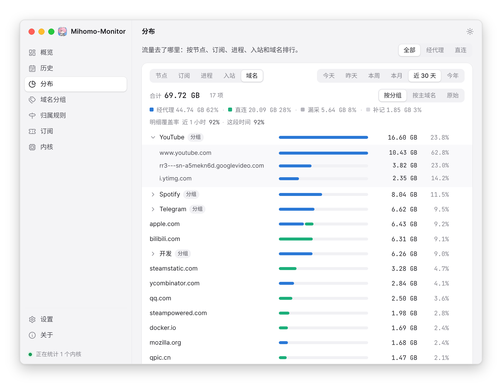
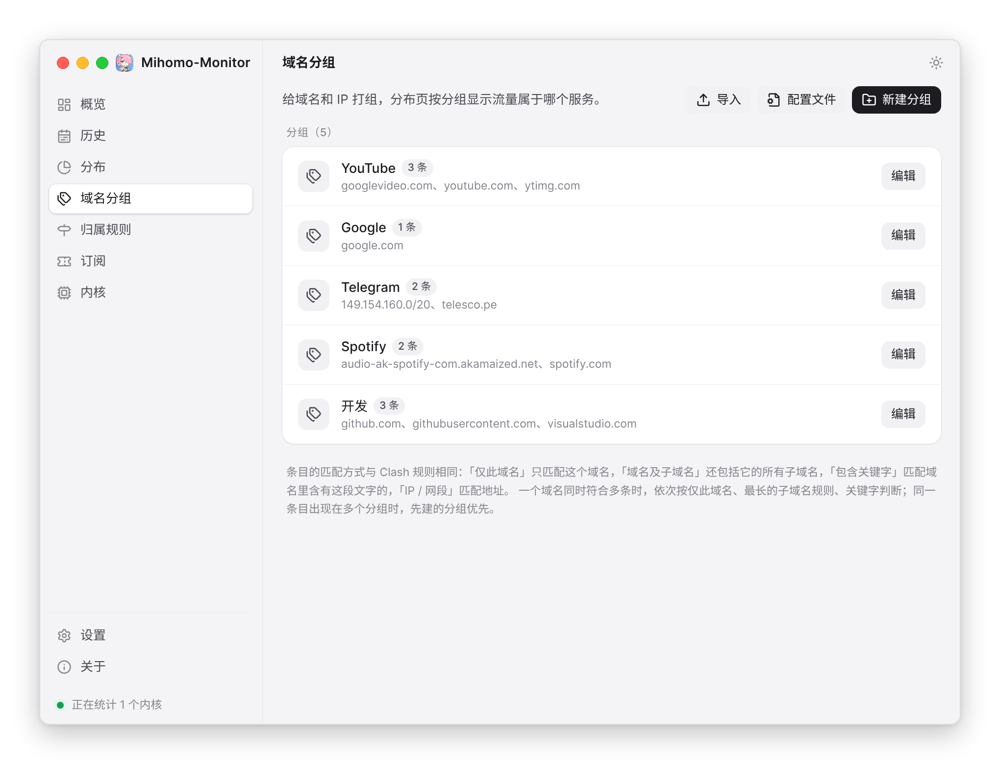
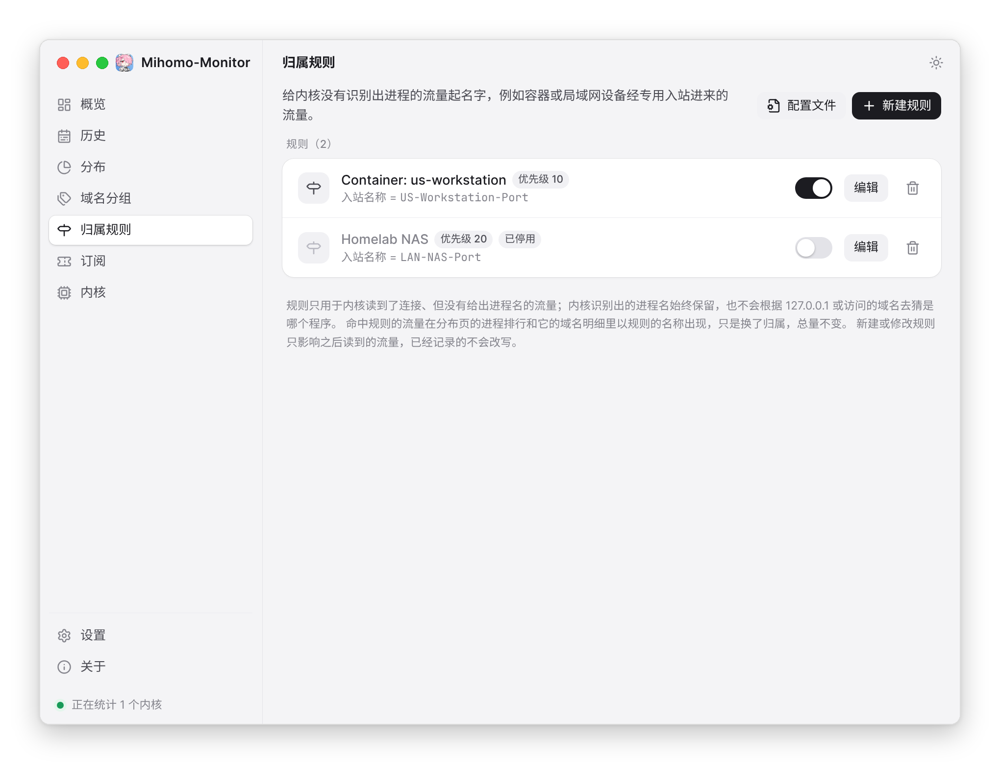

<div align="center">


# Mihomo-Monitor

**统计 mihomo 内核的流量，分类长期记账：直接读取你已经在用的 Clash 客户端，常驻托盘，几乎不占资源。**

基于 Tauri 2（Rust + React）构建，支持 Windows 与 macOS。


[](https://github.com/EverettRain/Mihomo-Monitor/releases/latest)

<picture>
  <source media="(prefers-color-scheme: dark)" srcset="docs/images/overview-dark.png">
  
</picture>

</div>

## 目录

- [功能概览](#功能概览)
- [快速开始](#快速开始)
- [内核发现](#内核发现)
- [历史](#历史)
- [分布](#分布)
- [域名分组](#域名分组)
- [归属规则](#归属规则)
- [订阅与计费周期](#订阅与计费周期)
- [统计口径](#统计口径)
- [后台常驻](#后台常驻)
- [数据存储](#数据存储)
- [开发](#开发)
- [发布](#发布)
- [路线图](#路线图)
- [已知限制](#已知限制)

## 功能概览

| 功能 | 说明 |
| --- | --- |
| 直接读取已有内核 | 自动找到 Clash Verge Rev 等客户端正在运行的 mihomo 内核，通过它的控制接口读取流量计数；不内置内核，不接管、不改动你的代理 |
| 长期记账 | 按 15 分钟记录、永久保存，按本地时间汇总成小时、日、周、月、年 |
| 经代理 / 直连 | 概览、历史和分布都可以只看经代理或只看直连的流量，进程和域名也按此区分，并列出三者的占比（含分不出的部分） |
| 不漏记 | 以内核自身的累计计数（`/connections` 的 `uploadTotal` / `downloadTotal`）为准；Mihomo-Monitor 退出或电脑睡眠期间，只要内核没有重启，流量会在下次读取时补回 |
| 实时速率与热力图 | 最近 5 分钟的下载与上传速率曲线，一年每天流量的热力图 |
| 历史 | 按小时、日、周、月、年翻看任意时段，用量最高的日子排行，自定义起止日期，导出 CSV |
| 分布 | 流量去了哪里：按实际出站节点、订阅、进程、入站和域名排行，展开进程可看它访问的域名 |
| 归属规则 | 内核认不出进程的流量（容器、局域网设备经专用入站进来）可以按入站名称起名字，计入进程排行 |
| 域名分组 | 给域名与 IP 打组（例如 YouTube、公司内网），分布页按分组合并显示；支持粘贴文本、CSV、JSON、Clash / sing-box 规则集导入 |
| 计费周期 | 每个订阅设置重置日与配额，显示本周期用量、预计周期末用量，用到 80% / 100% 时发系统通知，并与机场返回的已用量对照 |
| 多个内核 | 本机与路由器（OpenClash 等）的内核可以同时统计，分别查看或合计 |
| 常驻托盘 | 开机自启，托盘悬停显示今日用量；轻量模式下关闭窗口会连界面一起释放 |

## 快速开始

1. 从 [Releases](https://github.com/EverettRain/Mihomo-Monitor/releases/latest) 下载安装包：Windows 用 `Mihomo-Monitor_x.y.z_x64-setup.exe`；macOS 用 `.dmg`，Apple Silicon 选 `aarch64`，Intel 选 `x64`。macOS 版没有经过 Apple 公证，首次打开如提示“已损坏”或“无法验证开发者”，请运行 `xattr -cr /Applications/Mihomo-Monitor.app`。之后的版本可以在应用内更新。
2. 打开 Mihomo-Monitor。首次启动会开启开机自启，之后它在托盘（菜单栏）里运行。
3. 打开你平时用的 Clash 客户端（例如 Clash Verge Rev）。几秒内 **内核** 页会出现这个内核，状态为「正在统计」。
4. **概览** 页的「总览」显示今天、本周、本月、今年、近 30 天、日均、峰值单日与累计用量，最近 5 分钟的实时速率，以及一年的流量热力图；「趋势」按今天每小时或近 7 / 30 / 90 天每天显示下载与上传，悬停查看数值，也可以切换成表格。同时统计多个内核时，可以分别查看或合计。

页面右上角的「全部 / 经代理 / 直连」决定概览、历史和分布显示哪部分流量，切换页面后保留。选了经代理或直连时，卡片、趋势、热力图、历史表和导出的 CSV 都只算这一部分，图里仍然只有下载、上传两种颜色；旁边的一行列出这段时间经代理、直连、漏采和补记各占多少（见[统计口径](#统计口径)）。实时速率来自内核的 `/traffic`，无法区分，始终是全部流量。

第一次连接某个内核时，它此前累计的流量不会计入，统计从这一刻开始。

<div align="center">

</div>

<div align="center">

</div>

## 内核发现

Mihomo-Monitor 依次尝试下面几种方式，找到的每个候选都会先用 `GET /version` 确认是 mihomo 内核：

| 方式 | 说明 |
| --- | --- |
| 读取内核进程的启动参数 | 客户端通常用 `-d`、`-f`、`-ext-ctl-unix`、`-ext-ctl-pipe` 启动内核；Mihomo-Monitor 由此找到控制接口，必要时再读配置文件里的 `external-controller` 与 `secret` |
| 已知客户端的固定位置 | 读不到启动参数时（内核由客户端的服务或助手以 root / SYSTEM 启动），按下表检查各客户端放控制接口的位置 |
| 常用端口 | 以上都没有结果时，探测 `127.0.0.1` 的 9090 与 9097 端口；设置了 secret 时提示手动添加 |
| 手动添加 | 在 **内核** 页填写控制地址与 secret，适合路由器上的内核或没有被自动发现的内核 |

unix socket 与 Windows 命名管道不需要 secret（mihomo 不在这两个通道上校验 secret，靠文件权限限制访问），所以下表中除 FlClash 外的客户端通常不用做任何设置。只想统计路由器时，可以在 **内核** 页关闭「自动发现本机内核」。

各客户端的识别方式与控制接口位置（依据各项目 2026 年 11 月的源码）：

| 客户端 | 识别 | macOS 控制接口 | Windows 控制接口 | 实测 |
| --- | --- | --- | --- | --- |
| Clash Verge Rev | `verge-mihomo*` 进程 | `$TMPDIR/verge-mihomo.sock`、`/var/run/clash-verge-service/users/<uid>/verge-mihomo.sock` | `verge-mihomo*` 命名管道 | macOS 2.5.6 服务模式 |
| Clash Party（原 Mihomo Party） | 应用内 `sidecar` 目录里的 `mihomo` / `mihomo-alpha` / `mihomo-smart` | `/tmp/mihomo-party-<uid>-<pid>.sock` | `MihomoParty\mihomo-*` 命名管道 | 未实测 |
| Sparkle | 应用内 `sidecar` 目录里的 `mihomo` / `mihomo-alpha` | `/tmp/sparkle-mihomo-api*.sock` | `Sparkle\mihomo` 命名管道 | 未实测 |
| ClashX Meta | `com.metacubex.ClashX.ProxyConfigHelper.meta` 进程 | `/tmp/clashx_meta_*.sock`，或配置里的 HTTP 地址 | — | 未实测 |
| Clash Nyanpasu | 启动参数里的 `nyanpasu` 目录 | 运行目录配置里的 `external-controller-unix` | 运行目录配置里的 `external-controller-pipe` | 未实测 |
| FlClash | `FlClashCore` 进程 | 只有 HTTP，见下 | 同左 | 未实测 |

FlClash 关闭了内核的 socket 和命名管道，只有在设置里打开「外部控制器」**并且**设置了密钥时，才在 `127.0.0.1:9090` 开放 HTTP 控制接口。所以 FlClash 需要先在它的设置里打开外部控制器并设置密钥，再在 **内核** 页手动添加 `http://127.0.0.1:9090` 和这个密钥；**内核** 页会对 FlClash 给出相应提示。

## 历史

<div align="center">

</div>

| 视图 | 一页显示 |
| --- | --- |
| 小时 | 一天的每个小时 |
| 日 | 一个月的每一天 |
| 周 / 月 | 一年的每周、每月 |
| 年 | 全部年份 |
| 排行 | 用量最高的 20 天 |
| 自定义 | 任意起止日期，按天列出 |

每个视图有合计、柱状图和明细表（下载、上传、合计、占比、平均速率），可以前后翻页，也可以导出 CSV（带 BOM，Excel 直接打开不乱码）。平均速率按这段时间已经过去的部分计算。

## 分布

<div align="center">

</div>

| 维度 | 来源 |
| --- | --- |
| 节点 | 连接链路的第一跳（`chains[0]`），即实际出站的节点；直连显示为 DIRECT |
| 订阅 | 直连的流量不属于任何订阅（是否直连见[统计口径](#统计口径)）；节点来自 proxy-provider 时取 provider 名；Clash Verge Rev 会把订阅展开成普通节点，所以取它当时启用的配置名（`profiles.yaml` 的 `current`）；直连不属于任何订阅 |
| 进程 | 发起连接的程序。需要内核能查到进程：TUN 模式下通常默认可以，否则在配置中设置 `find-process-mode: always`。内核没给出进程名时，可以用[归属规则](#归属规则)命名；仍未命名的显示为「进程未识别」 |
| 入站 | 流量从内核的哪个入口进来，例如混合端口、TUN，或给容器、局域网设备单独开的端口 |
| 域名 | 连接的域名，没有域名时是 IP；可以按主域名合并（`a.cdn.example.co.uk` 计入 `example.co.uk`） |

时间范围可选今天、昨天、本周、本月、近 30 天、今年。每一行的条形按颜色分成经代理（蓝）、直连（青绿）和分不出的部分（灰）三段，一眼就能看出某个进程、域名或订阅有没有直连的流量、各占多少；悬停可以看到具体数值，合计下方那一行同时是颜色的图例。每个维度最后都有「漏采」和「补记」两行，是没有连接明细的流量（见[统计口径](#统计口径)）；再下面一行是明细覆盖率：最近约 1 小时和所选时段里，读取期间的流量有多少能对应到读到的连接，补记不算在内，所以过去的空档不会掩盖现在的情况。右上角选了经代理或直连时，每个维度都只算这一部分：例如进程排行只列经代理的流量，展开进程看到的也只是它经代理访问的域名；同一个程序既有经代理又有直连的流量时，两边各算各的。开始按经代理 / 直连记录之前的进程、入站和域名明细分不出走的是哪条路，筛选时单独列为「未区分是否经代理」，域名明细里不含这部分。

域名可以按分组（见下一节）、按主域名或原样显示；展开分组可看其中的域名，域名行末的按钮可以直接把它加入分组。

## 域名分组

<div align="center">

</div>

一堆 IP 和陌生域名很难看出属于哪个服务。**域名分组** 页可以把它们归到一个名字下，分布页按分组显示时，同一分组的流量合并成一行。页面列出所有分组，点「编辑」进入某个分组的编辑页，在那里添加、修改、删除条目，导入到这个分组，或者改名、删除分组；按 Esc 返回列表。

条目的写法与 Clash 规则相同：

| 匹配方式 | 写法 | 匹配 |
| --- | --- | --- |
| 域名及子域名 | `youtube.com`、`+.youtube.com`、`DOMAIN-SUFFIX,youtube.com` | 这个域名和它的所有子域名 |
| 仅此域名 | `DOMAIN,www.google.com` | 只有这个域名 |
| 包含关键字 | `DOMAIN-KEYWORD,youtube` | 域名中含有这段文字 |
| IP / 网段 | `149.154.167.51`、`91.108.4.0/22`、`IP-CIDR,…` | 地址落在这段范围内 |

一个域名同时符合多条时，依次按仅此域名、最长的子域名规则、关键字判断；地址按最长的网段判断；同一条目出现在多个分组时，先建的分组优先。

**导入**：可以粘贴文本或选择文件，导入前会预览识别结果，并列出无法识别的行和原因：

| 格式 | 说明 |
| --- | --- |
| 文本 | 每行一条：域名、IP、网段、网址（取其中的域名）、Clash 规则行、`+.example.com`；`#` 开头的是注释 |
| CSV / TSV | 分组、条目、类型三列，有无表头均可（表头可用 group / 分组、domain / 域名、type / 类型 等） |
| JSON | 字符串数组、`{"分组": ["条目", …]}`、对象数组、sing-box rule-set，以及旧版本导出的分组 JSON |
| YAML | Clash rule-provider（`payload:`，domain、ipcidr、classical 三种都可以） |

没写分组的条目加入导入时选择的分组；写了分组的按名字归入，不存在的分组自动新建。导入后每一条都可以单独修改匹配方式和内容、删除，也可以继续追加。

**配置文件**：域名分组和[归属规则](#归属规则)可以一起导出为一个 YAML 文件（「域名分组」或「归属规则」页的「配置文件」），用任意编辑器一次修改多个分组后再导入：

```yaml
version: 1
groups:                      # 先后顺序就是分组的优先顺序
  - name: "YouTube"
    note: ""
    entries:                 # 写法与 Clash 规则相同，也可以只写域名（含子域名）
      - "DOMAIN-SUFFIX,youtube.com"
      - "IP-CIDR,91.108.4.0/22"
attribution:
  - name: "Container: us-workstation"
    inbound: "US-Workstation-Port"
    priority: 10
    enabled: true
```

导入前会列出将要新增、修改、删除的分组和规则，以及无法识别的条目（这些会被跳过）。导入方式有两种：**以文件为准**（默认）时，文件里没有的分组和规则会被删除，分组顺序按文件；**只新增和更新**时，同名分组的备注和条目换成文件里的、同一入站的规则按文件更新，其余保留。文件里整段删掉 `groups` 或 `attribution`，那部分在导入时保持不变。在 YAML 的方括号列表里写 Clash 规则行时要加引号（`['DOMAIN,a.com']`），否则逗号会被当作分隔符。

## 归属规则

<div align="center">

</div>

内核只有在能查到进程时才给出进程名。容器、虚拟机或局域网设备经内核的某个入站进来时，内核通常不知道是哪个程序，这些流量在进程排行里都是「进程未识别」。如果给它们单独开了入站（例如 mihomo 配置里 `listeners` 的一个端口），就可以在 **归属规则** 页按入站名称给它们起名字，例如入站 `US-Workstation-Port` → `Container: us-workstation`。

| 设置 | 说明 |
| --- | --- |
| 显示名称 | 命中的流量在进程排行和它的域名明细里显示的名称，带「规则」标记 |
| 匹配条件 | 入站名称精确等于（区分大小写）；输入时会提示近 30 天出现过的入站 |
| 优先级 | 数字小的先匹配，相同时先建的优先 |
| 启用 | 停用的规则不参与匹配，可以随时再打开 |

- 规则只用于读到了连接、但内核没有给出进程名的流量；内核识别出的进程名始终保留。不会按 127.0.0.1、访问的域名等多个程序共用的特征去猜是哪个程序。
- 规则只影响之后读到的流量。已经记录的不会改写：新建规则不会把过去的「进程未识别」补成规则名，删除或改名后，过去的记录仍显示当时的名称。
- 规则只改变流量记在哪个名称下，不增加或减少任何流量，总量不变。
- 规则与域名分组保存在同一个配置文件里，可以一起导出、修改后导入，见[域名分组](#域名分组)。

## 订阅与计费周期

<div align="center">

</div>

**订阅** 页列出有流量经过的订阅（订阅的认定方式见上一节），可以为每个订阅设置计费周期：

| 设置 | 说明 |
| --- | --- |
| 重置 | 每月第 N 日的某个时刻（N 大于当月天数时在月末重置），或从某天起每隔 N 天；时刻以 15 分钟为单位。新建时默认取机场到期日的日期，多数机场按购买日每月重置 |
| 计量 | 上传 + 下载（多数机场如此），或仅下载 |
| 配额 | 可选，默认取机场返回的总量 |
| 提醒 | 用到配额的 50% / 80% / 90% / 100% 时发系统通知，默认 80% 与 100%；每个周期每条提醒线只通知一次 |

设置后显示本周期的起止、已用、剩余、按目前速度预计的周期末用量和日均；概览页与托盘悬停文字也会显示各周期的用量。

机场数据（已用、总量、到期时间）来自 Clash Verge Rev 保存的订阅信息，或内核里 proxy-provider 的订阅信息，与本地统计并排显示。两者通常不同：机场统计的是使用这个订阅的所有设备，还可能按节点倍率计费；开始按连接统计之前的流量也无法区分订阅。

## 统计口径

- **总量取自内核的累计计数。** 每次读数与上一次相减得到增量；计数变小说明内核重启过，此时当前计数全部是新流量。
- **断点续算。** 每分钟把增量和当前计数（检查点）在同一个事务里写入数据库。Mihomo-Monitor 重启后，如果内核还是同一个进程（进程号与启动时间都没变），中间的流量从计数差补回；内核换了进程且启动在检查点之后，它的全部计数都算新流量。内核与 Mihomo-Monitor 同时停止期间的流量无法找回。
- **补回的流量记在补回的时刻。** 中间这段时间里每一刻用了多少已经无从得知，所以按小时看时它会集中在恢复读取的那一格。
- **时区。** 数据按 UTC 存成 15 分钟一格。所有时区与 UTC 都相差整数个 15 分钟，所以换时区后按天汇总依旧准确；夏令时当天按 23 或 25 小时计算。
- **单位。** 1 GB = 1024 MB，与多数代理客户端和机场的计法一致。
- **按连接拆分。** 按设置里的采样间隔（默认 1 秒，可选 0.5 / 1 / 2 秒）读取 `/connections`：总量与各连接的计数取自同一时刻，每条连接的增长记到它的节点、订阅、进程、入站和域名上。内核总量里没有被读到的连接计入的部分有两种来源，分开记录：
  - **漏采**：读取期间，在两次读取之间开了又关的连接（以及其他连接最后一小段），看不出去向。间隔越短越少，但无法完全消除；每次读取约占 1 毫秒 / 千条连接。
  - **补记**：Mihomo-Monitor 没在读取时内核走过的流量：程序未运行、与内核断开，或开始按连接统计之前。恢复读取时从内核计数补回，总量不丢，但没有任何明细。
  
  内核的总量与各连接的计数是先后读出的，偶尔连接会比总量多出一点；多出的部分照常计入各连接，并从下一次的余量里扣回，所以记录的流量累计起来始终等于内核自己的计数，不会多记。升级到这一版之前的记录里，整个 15 分钟都没有连接明细的时段算作补记，其余仍是漏采。
- **经代理还是直连。** 按连接实际出站的类型判断：内核 `/proxies` 报告为 `Direct`（包括自己定义的 `type: direct` 出站）、`Reject`、`Pass` 等不经代理的类型算直连，其余算经代理。出站类型每 10 分钟读一次，出现没见过的出站时提前重读；读不到时按内置名称（DIRECT、REJECT、PASS）判断。每条记录（节点、订阅、进程、入站和域名明细）都带着它的路由，所以每个维度都能只看经代理或直连。漏采和补记看不出去向，不属于经代理或直连；四者加起来等于总量。升级前的记录只按它自己能说明的换算：节点按名称（内置名称算直连，其他算经代理，所以自定义的直连出站在升级前的记录里会算作经代理），订阅按是否为直连；进程、入站和域名明细不带这个信息，不作推测，只看经代理或直连时单列为「未区分是否经代理」。
- **域名的保留。** 今天的域名明细完整；过去的每一天只保留用量最高的 200 个（进程 × 域名），每个进程至少保留它自己的前 10 个，其余并入该进程的「其他」，进程的总量不受影响。
- **多个内核合计。** 同一份流量如果先后经过两个内核（例如本机内核的出站又经过路由器的内核），合计时会重复计算，概览页会提示。

## 后台常驻

- 主窗口在需要时才创建。**轻量模式**（默认开启）下关闭窗口会销毁界面，只留下 Rust 后台进程继续统计；关闭轻量模式时关窗只是隐藏，再打开更快。
- macOS 上没有窗口时，应用不出现在程序坞与切换器里。
- 后台对每个内核保持一条 `/traffic` 连接（每秒一行，用于实时速率），并按采样间隔读取 `/connections`（用于记账与拆分）。实时速率断开时会自己重连，不影响记账；`/connections` 偶尔读取失败只跳过这一次，连续失败 3 次才重新连接，每次中断都写进日志（`logs/monitor.log`）。增量在内存中累加，每分钟写一次盘；界面关闭时不向前端推送任何数据。
- 开机自启以 `--tray` 参数启动，不弹出窗口。

## 数据存储

| 系统 | 位置 |
| --- | --- |
| macOS | `~/Library/Application Support/Mihomo-Monitor` |
| Windows | `%LOCALAPPDATA%\Mihomo-Monitor` |

目录中有 `traffic.db`（SQLite，WAL 模式）、`settings.json` 与 `logs/`。可以用环境变量 `MIHOMO_MONITOR_HOME` 改用其他目录。数据库结构用 `PRAGMA user_version` 标记版本，升级时自动迁移。

## 开发

需要 Node.js 22、pnpm 11 与 Rust 1.95（`app/rust-toolchain.toml` 会自动选用）。

```bash
cd app
pnpm install
pnpm tauri dev          # 开发运行
pnpm typecheck          # 前端类型检查
pnpm test:rust          # Rust 测试
```

没有装 Clash 客户端也可以试用：用模拟内核，然后在 **内核** 页手动添加 `127.0.0.1:19090`。

```bash
python3 app/scripts/fake-mihomo.py --port 19090
```

代码按层组织（`domain` → `infra` → `service` → `shell`），设计说明见 [docs/design.md](docs/design.md)。

### README 截图

```bash
app/scripts/readme-screenshots.sh
```

只能在 macOS 上运行，使用已安装的 `/Applications/Mihomo-Monitor.app`。脚本用 `MIHOMO_MONITOR_HOME` 指向示例目录、关闭自动发现、只连模拟内核，并用 `app/scripts/demo-data.py` 生成一年的虚构流量，不会读到或改动你自己的内核与统计。需要给终端授予「辅助功能」与「屏幕录制」权限。

## 发布

1. 在仓库的 **Settings → Secrets and variables → Actions** 中添加 `TAURI_SIGNING_PRIVATE_KEY`（updater 签名私钥的内容，无密码；本地放在已被忽略的 `signing/updater.key`）。对应的公钥已写在 `app/src-tauri/tauri.conf.json`。
2. 修改 `app/package.json`、`app/src-tauri/Cargo.toml` 与 `app/src-tauri/tauri.conf.json` 中的版本号并提交。
3. 推送 `vX.Y.Z` 标签，`release.yml` 会构建 Windows 与 macOS（Apple Silicon、Intel）安装包，生成更新说明并发布；应用内的更新检查读取最新 Release 的 `latest.json`。更新说明默认按上一个标签以来的提交生成；存在 `docs/releases/vX.Y.Z.md` 时改用这份手写的说明。

想在发布前试装某个提交，可以在 Actions 页手动运行 **Test build**。

## 路线图

- [x] 托盘常驻、轻量模式、开机自启、自动更新
- [x] 内核发现（启动参数、配置文件、Clash Verge Rev / Clash Party / Sparkle / ClashX Meta 已知位置、手动添加）
- [x] 总量统计：日 / 周 / 月 / 年、实时速率、断点续算
- [x] 历史浏览：小时 / 日 / 周 / 月 / 年、排行、自定义时段、导出 CSV
- [x] 按节点、订阅、DIRECT、进程、入站、域名拆分
- [x] 按订阅设置计费周期与配额，提醒，对照机场返回的已用量
- [x] 域名分组：多种格式导入、逐条编辑，分布页按分组显示
- [x] 域名分组与归属规则合为一个配置文件，导入前预览变化
- [x] 归属规则：按入站名称给认不出进程的流量命名
- [x] 经代理 / 直连分开统计，概览、历史与分布（含进程与域名）可按其筛选
- [ ] 归属规则支持更多匹配条件（如来源 IP）
- [ ] 订阅改名后合并旧名称的历史
- [ ] 更多客户端的实测与适配

## 已知限制

- macOS 版未经 Apple 签名公证；从浏览器下载后首次打开如提示“已损坏”，请运行 `xattr -cr /Applications/Mihomo-Monitor.app`。Windows 版没有代码签名，SmartScreen 提示时选「更多信息 → 仍要运行」。
- 第一次连接某个内核时，它此前的累计流量不计入。
- 远程内核（手动添加的地址）看不到进程，只能靠计数是否变小来判断重启：如果它在 Mihomo-Monitor 停止期间重启，并且新的计数已经超过上次记录的值，这段时间会少记。
- 原版 Clash 与 Clash Premium 不支持，只支持 mihomo（Clash.Meta）内核。
- Clash Verge Rev 的订阅按当时启用的配置记账：全局 Merge / Script 增强从别处加入的节点，也会记到当前配置名下。
- 一个订阅同时在多台设备上使用时，这里只统计本机（或所添加内核）经过的流量，与机场显示的已用量不同。

## License

[MIT](LICENSE)
